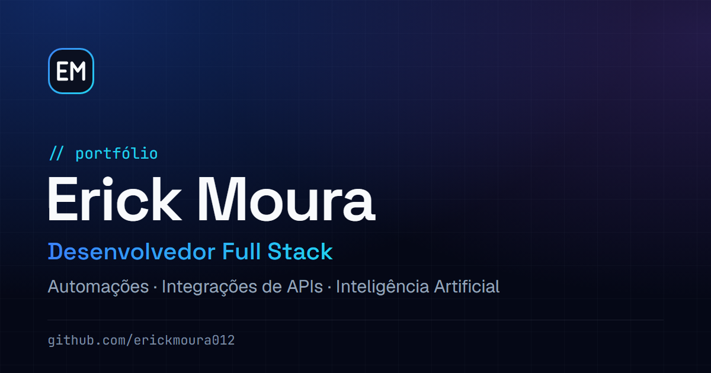

# Erick Moura — Portfólio

[](https://github.com/erickmoura012/erick-moura-portfolio/actions/workflows/ci.yml)

Portfólio profissional de **Erick Moura**, Desenvolvedor Full Stack com foco em Automações e
Inteligência Artificial. É uma aplicação React + TypeScript com páginas pré-renderizadas,
integração real com a API do GitHub, formulário de contato protegido por backend e um
painel administrativo para editar o conteúdo sem alterar código.



## Destaques

- **Integração real com o GitHub**: repositórios, linguagens e atividade pública vêm da API
  oficial, com cache, tratamento do limite de requisições e fallback para um snapshot
  versionado. Nenhum dado é simulado.
- **Funciona sem backend**: o conteúdo editorial é versionado e tipado. O Supabase acrescenta
  edição pelo painel, mensagens de contato e sincronização do GitHub no servidor.
- **SEO e performance**: HTML pré-renderizado (SSG) a partir do próprio React, metadados por
  página, Open Graph, JSON-LD `Person`, sitemap, code splitting e fontes auto-hospedadas.
- **Acessibilidade**: HTML semântico, navegação por teclado, foco visível, `prefers-reduced-motion`
  e verificação automatizada com axe (WCAG 2.2 AA) nos dois temas.
- **Segurança**: RLS em todas as tabelas, autorização do painel no banco, Edge Functions com
  validação Zod, rate limiting, honeypot e CSP restritiva sem scripts inline.
- **Extras**: paleta de comandos (<kbd>Ctrl</kbd>/<kbd>⌘</kbd> + <kbd>K</kbd>), modo terminal
  com comandos seguros, tema claro/escuro e página 404 temática.

## Stack

| Camada              | Tecnologias                                                                           |
| ------------------- | ------------------------------------------------------------------------------------- |
| Interface           | React 19, TypeScript (strict), Vite 8, Tailwind CSS 4, Motion, Radix UI, Lucide, cmdk |
| Dados e formulários | TanStack Query, React Hook Form, Zod                                                  |
| Backend             | Supabase: PostgreSQL + RLS, Auth, Storage e Edge Functions (Deno)                     |
| Integrações         | API REST/GraphQL do GitHub, Resend (e-mail)                                           |
| Qualidade           | ESLint, Prettier, Vitest, Testing Library, Playwright, axe-core, GitHub Actions       |
| Deploy              | Vercel (headers de segurança e URLs limpas)                                           |

Cada dependência tem um motivo técnico. Veja a justificativa em
[docs/ARCHITECTURE.md](docs/ARCHITECTURE.md).

## Como rodar

Pré-requisito: **Node.js 24** (ou 22.22+).

```bash
npm install
cp .env.example .env.local   # opcional: Supabase e URL do site
npm run dev                  # http://localhost:5173
```

Sem variáveis de ambiente, o site roda completo com o conteúdo versionado e os dados
públicos do GitHub.

### Scripts

| Comando                                    | O que faz                                                                   |
| ------------------------------------------ | --------------------------------------------------------------------------- |
| `npm run dev`                              | Servidor de desenvolvimento                                                 |
| `npm run build`                            | Typecheck + build + pré-renderização das páginas públicas, sitemap e robots |
| `npm run preview`                          | Serve o build de produção                                                   |
| `npm run check`                            | Typecheck, lint, testes e build (o mesmo que o CI)                          |
| `npm run typecheck` / `lint` / `format`    | Verificações individuais                                                    |
| `npm test`                                 | Testes unitários e de integração (Vitest)                                   |
| `npm run test:e2e`                         | E2E + acessibilidade no build (Playwright; rode `npm run build` antes)      |
| `npm run analyze`                          | Relatório do bundle (`stats.html`)                                          |
| `npm run sync:github`                      | Atualiza o snapshot do GitHub usado como fallback                           |
| `npm run seed:generate`                    | Gera `supabase/seed.sql` a partir do conteúdo versionado                    |
| `npm run assets:og` / `assets:screenshots` | Imagem de compartilhamento e capturas das demos                             |

## Estrutura

```text
src/
├── app/            providers, rotas, estilos e tokens do design system
├── components/     ui (primitivos), layout, common, animations
├── features/       uma pasta por área: home, about, experience, skills, solutions,
│                   projects, github, education, contact, command-palette, terminal, admin
├── content/pt-BR/  conteúdo editorial tipado
├── i18n/           textos de interface (preparado para novos idiomas)
└── entry-server.tsx
supabase/           migrations (schema + RLS), Edge Functions e seed
scripts/            pré-renderização, sincronização do GitHub, seed e assets
tests/e2e/          Playwright + axe
```

## Configuração e publicação

- [docs/DEPLOY.md](docs/DEPLOY.md): GitHub, Supabase (migrations, admin, segredos), Vercel,
  domínio próprio, checklist de produção e guia de manutenção.
- [docs/ARCHITECTURE.md](docs/ARCHITECTURE.md): decisões, fluxos de dados, segurança,
  performance e como adicionar inglês.

## Conteúdo e veracidade

As informações profissionais, os projetos e as tecnologias refletem a experiência real do
autor. Estudos de caso de trabalhos para clientes são apresentados apenas como arquiteturas
genéricas, sem nomes, credenciais ou detalhes internos.

## Contato

- LinkedIn: [linkedin.com/in/erickmouradev](https://www.linkedin.com/in/erickmouradev/)
- GitHub: [@erickmoura012](https://github.com/erickmoura012)
